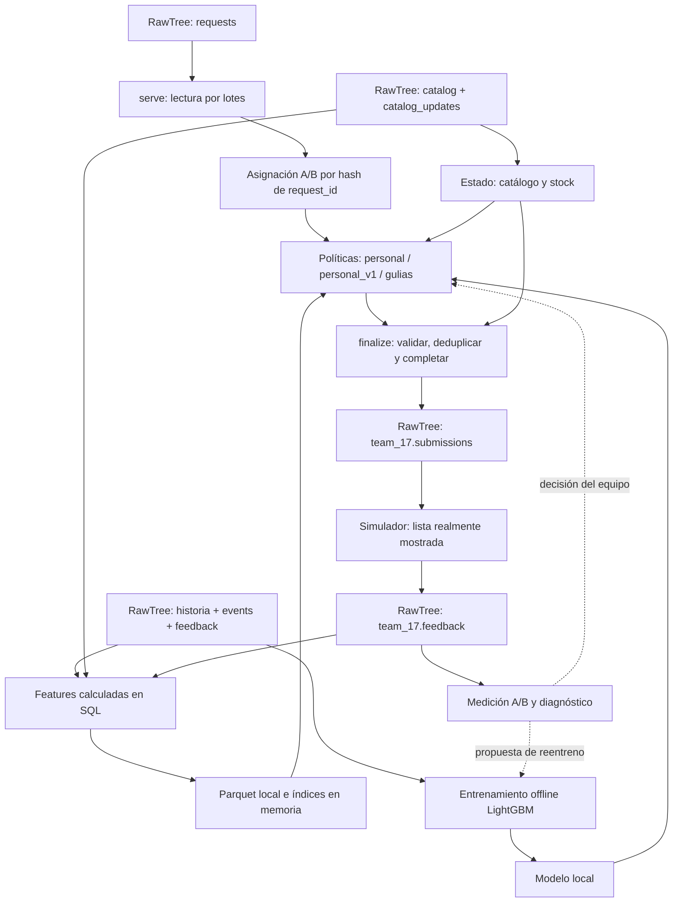

# Arquitectura del recomendador

Estado del código de este worktree, revisado el 14/11/2026. Describe capacidades implementadas; el despliegue efectivo se comprueba con `feedback.shown` y el informe, no con este diagrama.

| Pieza | Responsabilidad | Fichero |
| --- | --- | --- |
| Cliente | SELECT para lectura; inserción por API en el servicio. Configuración sin exponer la clave | `reco/client.py`, `reco/config.py` |
| SQL y features | Agrega popularidad, afinidades, vecinos y compras; combina historia y stream. Guarda derivados localmente | `reco/features.py`, `scripts/build_features.py` |
| Catálogo y stock | Aplica última actualización de producto, identifica agotados y prepara best sellers | `reco/catalog.py`, `reco/state.py` |
| Personal | Suma señales de sesión, vecinos, usuario, contexto y popularidad. La variante v2 filtra categorías de sesión; v1 conserva la referencia | `reco/policies/personal.py` |
| Ranker gulias | Genera candidatos y puntúa con LightGBM; prioriza categoría de última vista y excluye compras conocidas del usuario | `reco/ranker.py`, `reco/policies/ranker.py` |
| Aprendizaje offline | Corte temporal, métricas con corrección por propensión, ajuste de pesos y entrenamiento | `reco/evaluate.py`, `scripts/tune.py`, `scripts/train_ranker.py` |
| Servicio y A/B | Polling, asignación determinista `crc32(request_id) % número_de_brazos`, predicción, validación e inserción por lotes | `reco/serve.py` |
| Seguridad de lista | Conserva solo IDs válidos, distintos, activos y en stock; completa con fallback hasta diez si existe oferta suficiente | `reco/safety.py` |
| Observación | Feedback y comparación entre brazos; el informe de presentación resuelve duplicados comparando la lista mostrada | `scripts/monitor.py`, `scripts/ab.py`, `scripts/report.py` |

El camino crítico usa índices en memoria. `recommend()` no recalcula tablas ni entrena. Personal solicita la reconstrucción de features en un subproceso; después carga los Parquet y sustituye su índice. Gulias también reconstruye features en un subproceso y añade compras del feedback a sus exclusiones. El estado refresca catálogo y stock en un hilo. La carga local y algunas consultas de refresco aún pueden consumir tiempo: la separación de procesos reduce el riesgo, no demuestra ausencia de bloqueo.

**Aprender no significa reentrenar automáticamente.** Se actualizan señales e índices desde el stream; el modelo LightGBM se entrena con un script separado. La selección de brazos y los reentrenos son decisiones del equipo. No hay un bandido adaptativo que cambie automáticamente el tráfico según el ganador.

El informe ejecuta exclusivamente SELECT, fija un máximo de tiempo de feedback al empezar y descarga tramos de una hora con un límite inferior a medio millón de filas por consulta. Es independiente del servicio; no debe ejecutarse dentro del bucle de recomendaciones. Las figuras son una foto del feedback disponible, que puede llegar con retraso.
